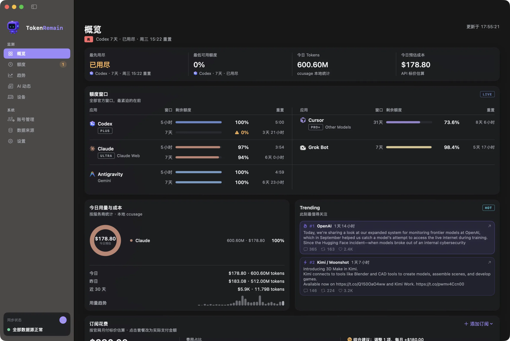
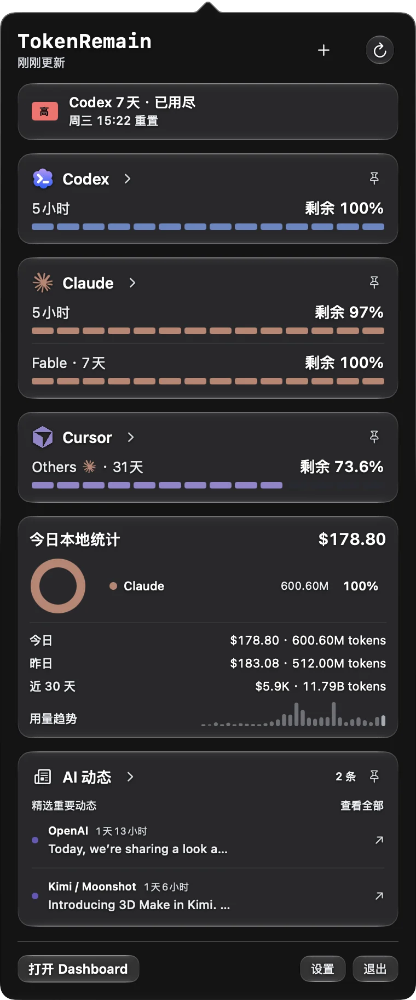
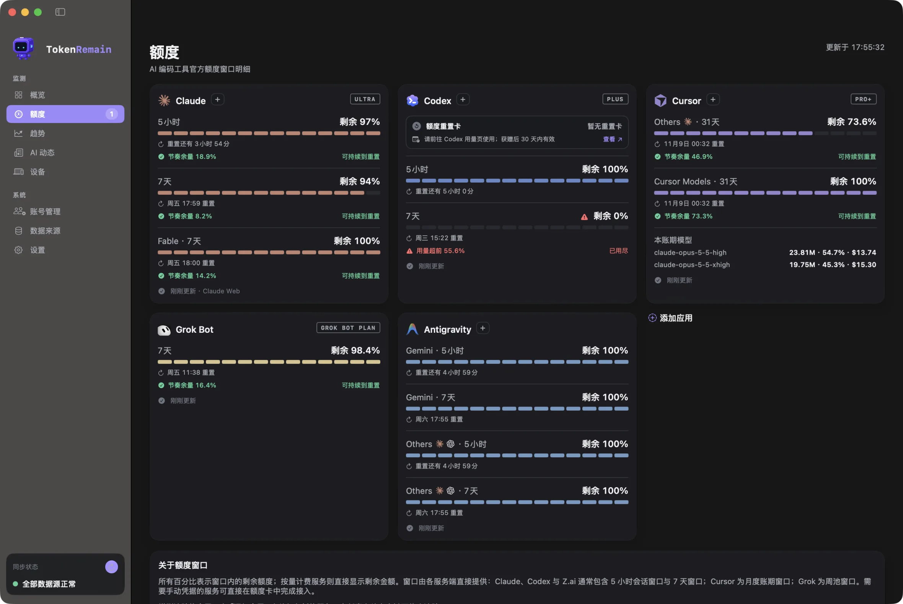
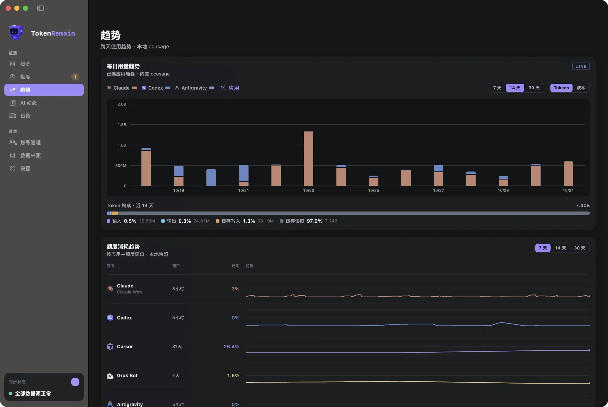
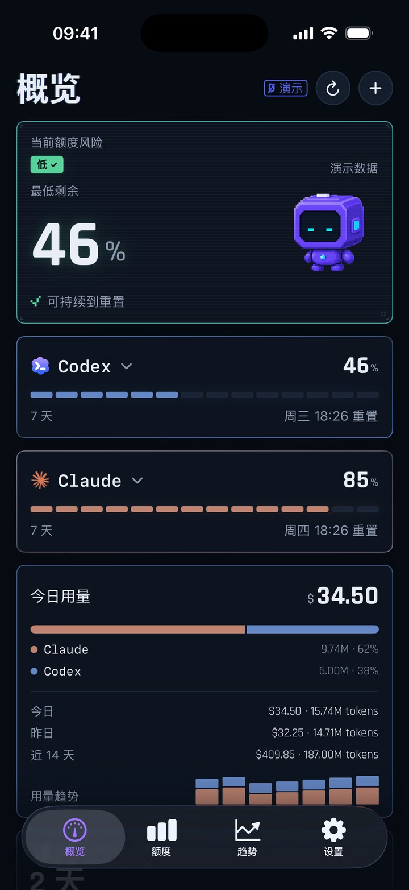
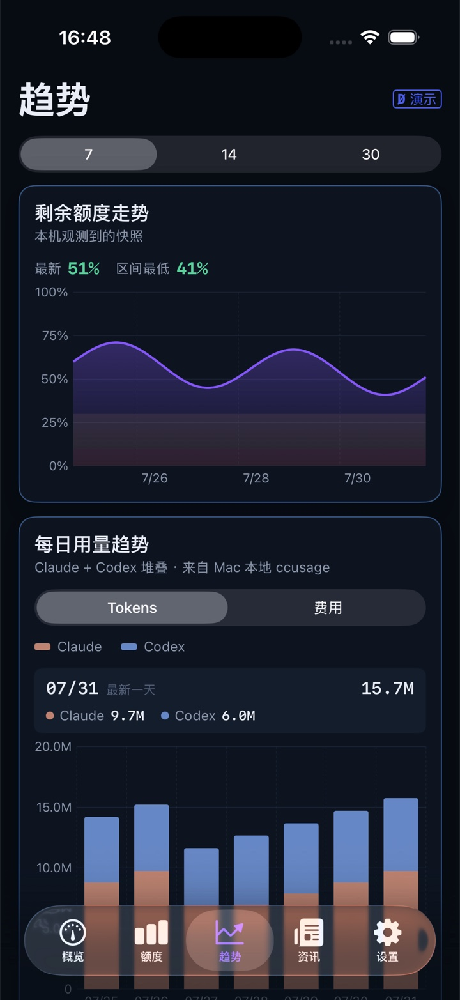
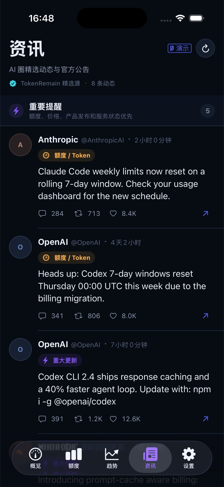
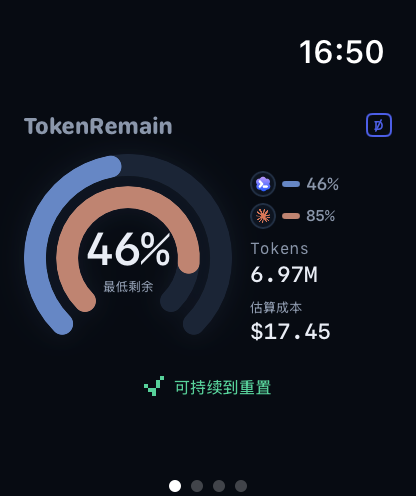
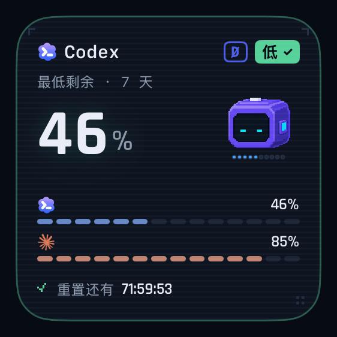
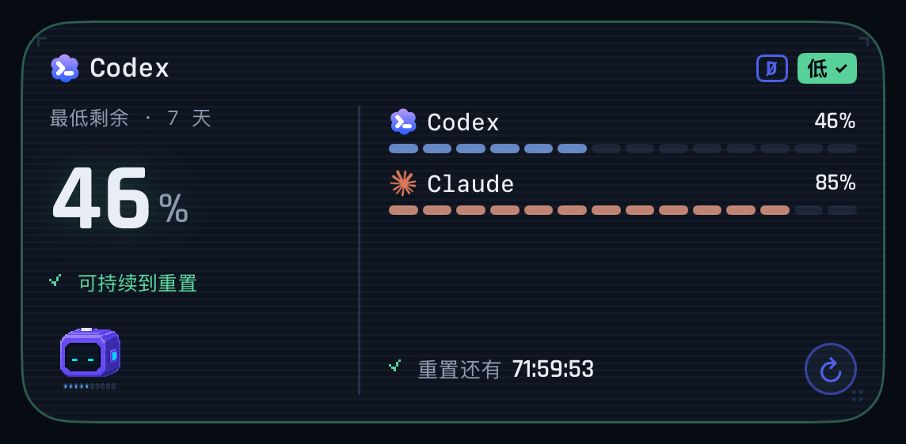

<div align="center">

<a href="https://tokenremain.com"></a>

# TokenRemain

**AI 编码工具的剩余额度，常驻 Mac 菜单栏。**<br/>
凭证只留在本机：只读、不刷新、不上传。

<p>
  <a href="https://github.com/Carstin520/token-remain/releases/latest"></a>
  
  
  <a href="LICENSE"></a>
</p>

<h3><a href="https://api.tokenremain.com/v1/downloads/macos">⬇️ 下载 TokenRemain.dmg</a></h3>

<a href="https://tokenremain.com">官网</a> ·
<a href="https://testflight.apple.com/join/DU3DrnhG">iPhone 测试版</a> ·
<a href="CHANGELOG.md">更新记录</a> ·
<a href="https://tokenremain.com/privacy">隐私政策</a> ·
<a href="https://github.com/Carstin520/token-remain/issues">问题反馈</a> ·
<a href="README.md">English</a>

</div>

<br/>

<p align="center">
  
  
</p>
<p align="center"><sub>Claude Code、Codex、Cursor、Grok、GLM 等 27+ 家工具的剩余额度、重置倒计时与今日成本，一屏看完。（真实使用数据截图）</sub></p>

> [!TIP]
> **1.5.1 新功能**：重新设计的 Dashboard 与菜单栏弹窗。概览页把最先用尽的额度、今日 Token 与成本、全部额度窗口和 AI 热门动态放在同一页；额度行只写「5小时」「Fable · 7天」，数据来源移到 Dashboard 的小字里；套餐标签跟随「订阅花费」卡片；每日用量趋势新增「应用」菜单，可自行增删应用。首次打开时数字与进度条滚动入场，按钮有回弹和波纹反馈，弹窗与 Dashboard 淡入淡出——全部遵循系统的「减弱动态效果」。更早的版本见[更新记录](CHANGELOG.md)。

## 功能

### 🧭 额度：撑不撑得到重置，一眼就知道

- **27+ 家工具并排展示**：每个官方额度窗口都带进度条、重置倒计时和更新时间；概览页用一张表列出全部窗口，最紧迫的排在前面。
- **节奏预测**：按真实窗口进度判断当前节奏能否撑到重置，撑不到时给出预计可用时长。
- **干净的额度行**：每条进度条只写额度池和窗口时长（「5小时」「Fable · 7天」）；数据来自哪里（例如 Claude Web）只在 Dashboard 的小字里出现一次。
- **多账号**：同一工具的多个账号分别显示；一个应用有多个账号时，非默认账号会在其额度行上方用小字标出名称。「账号管理」页可按应用开关监控、启停账号、重命名、更新凭证。
- **随处可见**：菜单栏胶囊、跨空间浮窗、Dock 图标双仪表（两款应用自选）；macOS 26 上的 Liquid Glass 弹窗高度跟随展开的卡片变化，卡片顺序可自由调整。

### 📊 用量：Token 花在哪、实际付多少

- **今日成本**：内置 ccusage 离线统计 15+ 种本地编码 Agent（含 Claude Desktop / Cowork），按官方 API 标价估算。
- **趋势图自己选**：每日用量趋势的「应用」菜单可增删应用。TokenRemain 能读取本地日志的工具即使近期没有记录也可勾选；只有额度数据的应用会单独列出，说明为什么无法绘制。
- **Token 构成与输出速度**：输入、输出、缓存写入、缓存读取分开统计；点击任意一天展开按模型的明细，并显示从本机 Claude Code 与 Codex 日志估算的端到端 tok/s。
- **订阅花费**：按月列出套餐价格，支持按账号覆盖价格与套餐、排除公司报销的账号，并根据用量给出升降级建议；概览与额度页的套餐标签跟随这里的设置。
- **显示币种**：USD、CNY、EUR、JPY 等 13 种；只换算 API 标价估算，官方账单与余额保持原币种。

### 🔐 隐私：凭证从不离开你的 Mac

- **只读本机已有凭证**：无需注册账号，无遥测，不刷新第三方 token，不上传凭证。
- **可选加密同步**：默认关闭；开启后只把白名单字段组成的快照加密写入你自己的 iCloud，供 iPhone、Apple Watch 与桌面小组件显示。
- **AI 动态与热门**：精选 Anthropic、OpenAI 等官方账号的动态，以单列方式阅读，优先级最高的几条显示在概览页；额度重置与重大更新可推送本机通知。
- **低能耗**：后台 CPU 比 v1.2.2 降低 95%（[测试方法](docs/performance-v1.2.3.md)），1.5 进一步减少了后台唤醒与内存占用；界面支持简体中文、繁體中文、English、日本語、한국어 等多种语言。

## 界面一览

<table>
  <tr>
    <td width="50%"></td>
    <td width="50%"></td>
  </tr>
  <tr>
    <td><b>额度</b> · 每个窗口的剩余、重置时间与节奏余量，超前时标红并给出预计用尽时间。</td>
    <td><b>趋势</b> · 按应用堆叠的每日 Token 或成本（在「应用」菜单里挑选），Token 构成，以及各额度窗口的消耗速度。</td>
  </tr>
</table>

<details>
<summary><b>更多截图</b>：iPhone、Apple Watch 与小组件</summary>
<br/>

<p align="center">
  
  
  
  
</p>
<p align="center">
  
  
</p>

iPhone 版目前为 [TestFlight 公开测试](https://testflight.apple.com/join/DU3DrnhG)；数据由 Mac 单向加密发布，移动客户端源码不在本仓库开源范围内。

</details>

## 快速上手

1. **安装**：[下载 DMG](https://api.tokenremain.com/v1/downloads/macos)，把 TokenRemain 拖进「应用程序」后打开。
2. **选择工具**：欢迎页会扫描本机已安装的 AI 工具，勾选要追踪的即可。凭证沿用各工具自己的登录，无需在 TokenRemain 里再登录；Codex 可沿用官方桌面 App 的登录。
3. **补充密钥**：Z.ai、OpenRouter 等需要 API Key 的服务，直接在对应额度卡里粘贴，或在「数据来源」页的「API Key 设置」中填写。密钥只存本机钥匙串。
4. **按需调整**：在「设置 › 刷新与同步」调整额度刷新频率（1–30 分钟或仅手动）；在「设置 › 通用」选择 Dock 图标显示的两款应用和显示币种；在「概览 › 订阅花费」填写实际支付的金额；在趋势页的「应用」菜单里挑选要显示的应用。

> [!NOTE]
> Claude Code / Cowork 的本地 Token 统计无需额外安装 CLI。Claude 额度需要可读取的 Claude Code 登录，或在「数据来源」中手动配置 claude.ai 会话（见[常见问题](#常见问题)）；仅登录 Claude 桌面 App 不保证能续期 Code 凭证。

## 支持接入的应用

🟢 **自动** = 登录对应工具即接入 · 🔑 **API Key** = 粘贴一次密钥，仅存 macOS 钥匙串

| 应用 | 接入 | 读取内容 |
| :-- | :-: | :-- |
|  **Claude Code** | 🟢 | 5 小时 / 7 天窗口；第三方 `ANTHROPIC_BASE_URL` 标注实际 API |
|  **Codex** | 🟢 | 5 小时 / 7 天窗口、重置卡；自定义 `base_url` 标注实际 API |
|  **Cursor** | 🟢 | 月度账期额度，Cursor 模型与其他模型分池显示 |
|  **Grok**（xAI） | 🟢 | 周池剩余额度 |
|  **Grok Bot** | 🟢 | 周额度；通过本机 Cursor 登录读取，需与 Grok Bot 使用同一 Cursor 账户 |
|  **GitHub Copilot** | 🟢 | 月度 Credits |
|  **Devin** | 🟢 | 日 / 周配额 |
|  **Windsurf** | 🟢 | 日 / 周配额 |
|  **Antigravity** | 🟢 | 配额池 |
|  **OpenCode** | 🟢 | 套餐本地估算；第三方 provider 标注实际 API |
|  **Z.ai / 智谱** | 🔑 | Coding Plan 额度；macOS 国内站另支持普通 API Key 的人民币余额（中国 → API 余额） |
|  **OpenRouter** | 🔑 | Key 限额、Credits 与账户余额 |

<details>
<summary><b>另外 16 家扩展 Provider</b>与本地成本来源</summary>
<br/>

| 应用 | 接入方式 | | 应用 | 接入方式 |
| :-- | :-- | :-- | :-- | :-- |
|  **DeepSeek** | API Key | |  **Qoder** | Cookie |
|  **Kimi** | API Key / Cookie | |  **Kiro** | `kiro-cli /usage` 解析 |
|  **MiniMax** | API Key | |  **火山引擎** | AK:SK 签名 |
|  **MiMo Code** | Cookie | |  **Ollama** | session Cookie |
|  **GLM Team** | API Key + Org + Project | |  **阿里云百炼 Token Plan** | 控制台 Cookie |
|  **Amp** | 自动读取 Amp CLI 的 Key，或 Cookie | |  **Muse** | Cookie（muse.ai） |
|  **Muse Code** | Cookie（dev.meta.ai），按团队读取 | | **Factory** | Cookie（app.factory.ai） |
| **Augment** | Cookie（app.augmentcode.com） | | **第三方 API** | New API / 自定义余额接口 |

**Cookie 型服务怎么接入**：在浏览器登录对应网站后，从开发者工具复制请求里的 Cookie 值（或右键请求「复制为 cURL」），粘贴到该服务的额度卡，或在接入引导里点「从剪贴板粘贴」即可（也可用 `QODER_COOKIE`、`MIMO_COOKIE`、`OLLAMA_COOKIE`、`MUSE_COOKIE`、`MUSE_CODE_COOKIE`、`AMP_COOKIE`、`FACTORY_COOKIE`、`AUGMENT_COOKIE` 环境变量提供）。Cookie 与 API Key 一样只存本机钥匙串；TokenRemain 从不读取浏览器自身的 Cookie 存储。Cookie 等同于登录凭证，请勿分享；退出网站登录后它会失效，需要重新粘贴。

**本地成本来源**：内置 ccusage 动态发现 Claude Code、Codex、Gemini、Antigravity、Goose 等 15+ 种本地 Agent，并合并 `~/.claude`、`~/.config/claude`、`CLAUDE_CONFIG_DIR` 与 Claude Cowork 的会话目录（自动去重，可在「数据来源」页添加自定义目录）；Trae 只读取所选目录中的时间、模型与 Token 计数。托管模型按官方标价估算，Ollama 等本地模型记零成本；价格未知时仍保留 Token 数。

</details>

## 隐私

```
你机器上已有的凭证 ──只读──▶ 各服务商官方 API ──▶ 本地渲染并缓存
```

每一条都附有可核对的源码或测试：

- **只读凭证，绝不刷新**：只读各工具自己维护的 token，从不写回、不争用 refresh token；后台读取关闭钥匙串交互，不会弹出授权窗。 <sub>🔍 [契约脚本](script/verify_keychain_read_contract.sh) · [测试](Tests/UsageDockTests/KeychainReadTests.swift#L45) · [源码](Sources/UsageDock/Services/ClaudeOAuthUsageService.swift#L9)</sub>
- **手动密钥只进本机钥匙串**：粘贴的 API Key 存入 macOS 钥匙串，且禁止同步到 iCloud 钥匙串。 <sub>🔍 [源码](Sources/UsageDock/Services/KeychainSecretStore.swift#L176) · [测试](Tests/UsageDockTests/AppOwnedKeychainTests.swift#L15)</sub>
- **无账号、无遥测、无凭证中转**：额度查询直连各服务商官方 API；依赖只有 Sparkle 与本仓库的同步包，没有任何分析 SDK。 <sub>🔍 [依赖清单](Package.swift)</sub>
- **价格与汇率更新不带任何本机数据**：价格表每天至多一次无 body、无参数、无认证头的 GET；只有选择 USD 以外的币种时，才向公开汇率接口发出同样固定的请求。 <sub>🔍 [价格测试](Tests/UsageDockTests/CCUsagePricingServiceTests.swift#L19) · [契约脚本](script/verify_bundled_ccusage_contract.sh#L42) · [汇率源码](Sources/UsageDock/Services/ExchangeRateService.swift)</sub>
- **同步默认关闭，端到端加密**：开启后，只有白名单字段组成的展示快照在本机 AES-GCM 加密，再写入你自己的 iCloud 私有库。 <sub>🔍 [默认关闭测试](Tests/UsageDockTests/CrossDeviceSyncDefaultsTests.swift#L8) · [字段白名单](Sources/UsageDock/Sync/MobileSnapshotRedactor.swift#L7) · [加密实现](Packages/TokenRemainSyncKit/Sources/TokenRemainSyncKit/EncryptedSyncEnvelope.swift#L66)</sub>

**其他联网行为**（均不携带凭证或用量）：AI 动态从 `api.tokenremain.com` 拉取公开内容，通知默认关闭，开启后才用随机安装 ID 注册推送；服务状态读取 `status.openai.com`、`status.claude.com` 的公开接口；非 USD 显示币种读取 `open.er-api.com` 的公开参考汇率；更新检查读取 GitHub 上签名的 appcast；局域网直连同步监听 TCP 47831，只接受已配对设备。

细节见[隐私政策](https://tokenremain.com/privacy)。

## 常见问题

<details>
<summary><b>卡片提示「未检测到登录」</b></summary>
<br/>

TokenRemain 从不刷新 token，只读取工具自己保存的登录状态。到对应工具里重新登录并正常使用一次，数据会自动恢复；Antigravity 等工具需要先打开使用一次，凭证才会写到本机。

</details>

<details>
<summary><b>为什么每日用量趋势里只有部分应用？</b></summary>
<br/>

这张图绘制的是本地日志里的逐日 Token，只有会写本地日志的应用才能出现。内置 ccusage 能读取日志的工具（Claude Code、Codex、Gemini CLI、Antigravity、OpenCode 等）即使近期没有记录，也能在「应用」菜单里勾选，一旦产生记录柱子就会出现。Cursor、Grok Bot 这类 TokenRemain 只拿得到额度数据的应用列在「只有额度数据」下：它们没有可绘制的本地 Token 日志，但额度照常显示在其他页面。

</details>

<details>
<summary><b>没有安装 Claude Code CLI，怎么看 Claude 额度？</b></summary>
<br/>

在「数据来源」的 Claude 行粘贴你自己的 claude.ai `sessionKey` 或 Cookie。验证成功后只保存在本机钥匙串、不参与 iCloud 钥匙串同步；TokenRemain 不会导入浏览器 Cookie，也不会刷新第三方凭证。配置后默认 Claude 额度明确来自该网页账号，独立 CLI 账号仍使用各自凭证；移除 Cookie 即恢复本地 OAuth。多个组织无法唯一匹配时需要填写目标组织 UUID。

该网页接口不是公开接口，访问质询、会话过期或网络失败都可能导致暂时无法读取，此时卡片保留上一次的额度和原更新时间。

</details>

<details>
<summary><b>Claude 显示「用量读取超时」或「无法连接 Claude 服务」</b></summary>
<br/>

此时卡片显示的是最近一次成功的缓存，网络恢复后自动重试，不会要求你重新登录。官方 API 走系统代理；凭证过期需要借助 Claude Code CLI 续期时，TokenRemain 会依次尝试 App 环境变量、Claude Code `settings.json` 的 `env`、系统代理（含 PAC）和登录 shell 导出的代理变量，选第一条能连通 `api.anthropic.com` 的。仍无法恢复时，可在终端运行一次 `claude` 并执行 `/usage`。

</details>

<details>
<summary><b>Claude 桌面 App / Cowork 的用量会被统计吗？</b></summary>
<br/>

会。本地统计自动合并 `~/.claude`、`~/.config/claude`、继承的 `CLAUDE_CONFIG_DIR` 和 Claude Cowork 的 `.claude/projects` 目录，由内置 ccusage 离线读取并去重；「数据来源」页可以查看发现的目录，也能添加包含 `projects` 的自定义配置目录。普通聊天、网页和手机会话不产生本地 Token 日志，因此不会计入。

</details>

<details>
<summary><b>顶部预警和卡片上的百分比不一致</b></summary>
<br/>

预警取所有窗口中最紧缺的一个（通常是 7 天窗口），卡片第一行显示的是最短的窗口，两者不是同一个窗口。

</details>

<details>
<summary><b>今日成本和我的账单对不上</b></summary>
<br/>

成本按官方 API 标价估算本地 Token 用量，用于衡量用量规模，不等于订阅账单；实际支付的金额可以在「概览 › 订阅花费」里填写。切换显示币种只换算这部分估算值，官方账单金额与账户余额始终保持原币种。

</details>

<details>
<summary><b>tok/s 是怎么算的？</b></summary>
<br/>

TokenRemain 在每次本地统计刷新后，增量读取 Claude Code 与 Codex 会话日志新追加的部分，只提取时间戳、模型名与 Token 计数，估算各模型的端到端输出速度（包含首 Token 延迟）。扫描在低优先级下进行，有时间和数据量上限，结果只保存在本机。

</details>

<details>
<summary><b>卡片标注了「第三方 API」</b></summary>
<br/>

Claude Code 设置了 `ANTHROPIC_BASE_URL`，或 Codex 配置了自定义 `base_url` 时，额度来自实际提供服务的 API，卡片会注明来源。如果你用的是官方登录却被这样标注，请[提交 issue](https://github.com/Carstin520/token-remain/issues) 并附上脱敏后的配置。

</details>

<details>
<summary><b>如何彻底卸载</b></summary>
<br/>

退出 TokenRemain 并删除 App 后，可清理本地偏好与缓存：

```bash
defaults delete com.jamesli.usagedock
rm -rf ~/Library/Caches/com.jamesli.usagedock ~/Library/Application\ Support/com.jamesli.usagedock
```

手动粘贴的密钥可在「钥匙串访问」中搜索 `com.jamesli.usagedock` 删除。开启过同步的话，如需清除 iCloud 中的数据，请[联系支持](https://tokenremain.com/support)。

</details>

还有问题？请[提交 issue](https://github.com/Carstin520/token-remain/issues) 或查看[支持页](https://tokenremain.com/support)。

## 参与开发

欢迎提交 issue 与 PR。构建、测试、目录结构与代码约定见 [CONTRIBUTING.md](CONTRIBUTING.md)；安全问题请按 [SECURITY.md](SECURITY.md) 私下报告，不要公开提交 issue。

## 下载趋势

<div align="center">

<picture>
  <source media="(prefers-color-scheme: dark)" srcset="https://api.tokenremain.com/v1/downloads/chart.svg?theme=dark&amp;lang=zh" />
  <source media="(prefers-color-scheme: light)" srcset="https://api.tokenremain.com/v1/downloads/chart.svg?theme=light&amp;lang=zh" />
  
</picture>

<sub>基线为截至 2026-08-07 的 163 次历史下载（[明细](docs/download-baseline.md)），此后由匿名下载入口即时累计，并每小时与 GitHub 上的 DMG 下载总数对账，不含任何个人数据。</sub>

</div>

## 致谢

- [token-monitor](https://github.com/Javis603/token-monitor)（MIT）：扩展 Provider 的额度读取逻辑移植自此项目，桌面浮窗与偏好设计也受其启发。
- [ccusage](https://github.com/ryoppippi/ccusage)（MIT）：随 App 内置，用于统计本地 Agent 的 Token 用量。
- [OpenUsage](https://github.com/robinebers/openusage)（MIT）：Claude 限额 API 直查的 provider 设计参考。
- [LiteLLM](https://github.com/BerriAI/litellm)：公开的模型价格表。
- [ExchangeRate-API](https://www.exchangerate-api.com)：显示币种使用的公开参考汇率。
- [Sparkle](https://github.com/sparkle-project/Sparkle)（MIT）：签名自动更新。

第三方版权与许可声明见 [NOTICE](NOTICE)。

## 许可

源代码与源文档采用 [Apache License 2.0](LICENSE)；TokenRemain 名称、Logo、图标、机器人形象与原创设计素材不在授权范围内，详见[品牌与素材许可说明](ASSET-LICENSE.md)。

<sub>TokenRemain 是独立应用，与 Anthropic、OpenAI、Anysphere、xAI、GitHub、智谱 AI 或任何服务商均无隶属、背书或赞助关系；服务名称与标识仅用于标示你可选择接入的服务。发布者与支持联系人：Dongheng Li · jamescarstin520@gmail.com · © 2026</sub>
